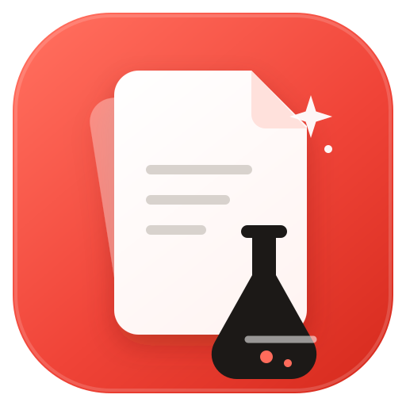
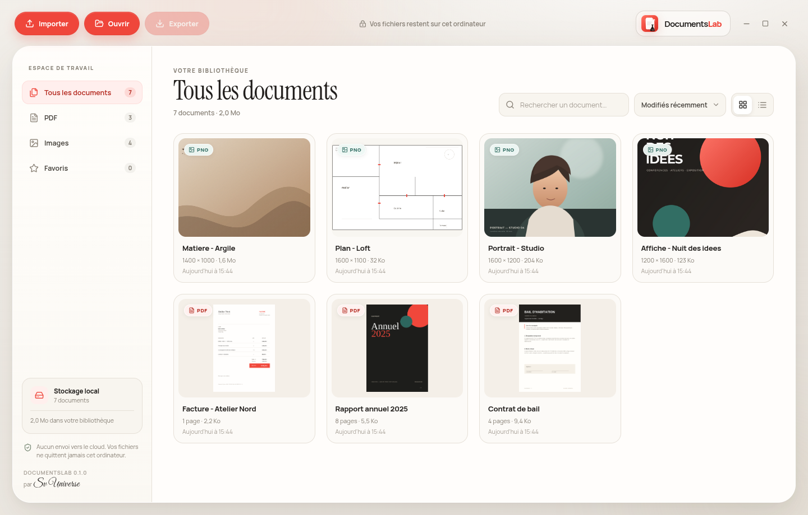
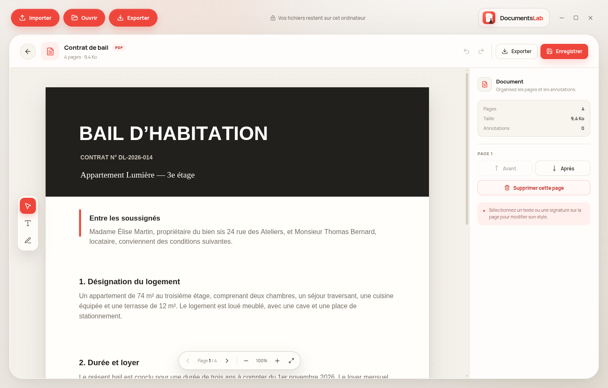
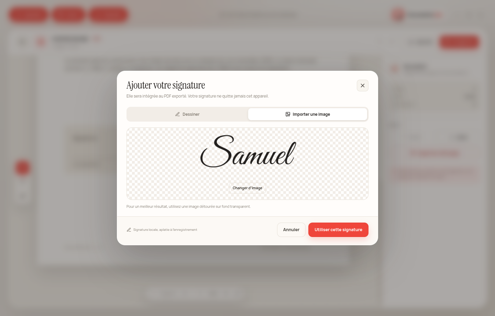
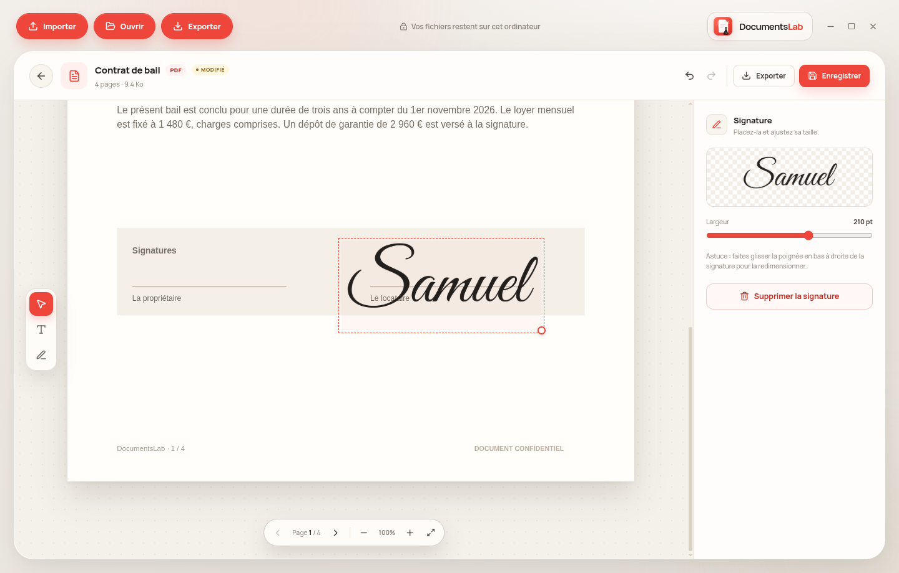
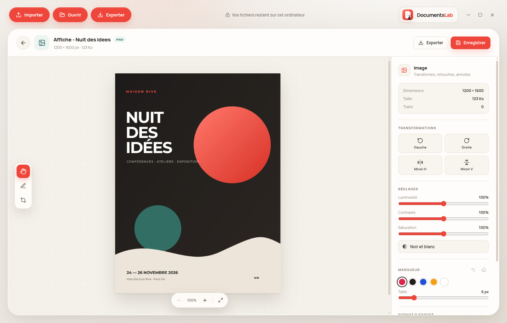
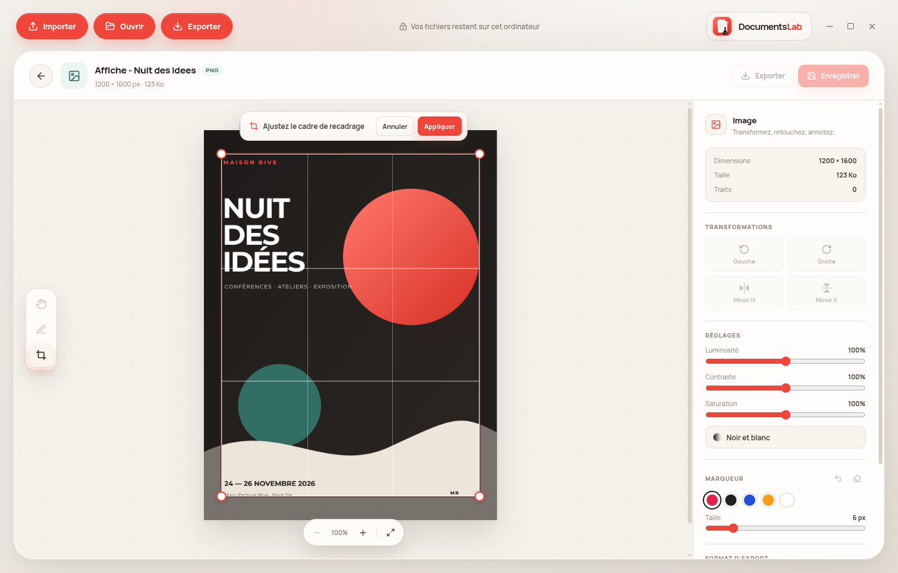
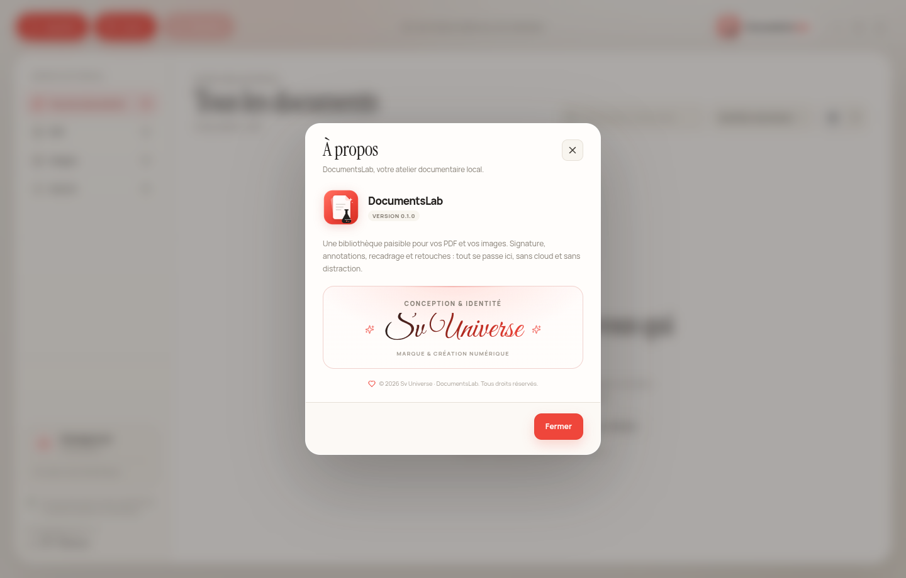

<div align="center">
  

  <h1>DocumentsLab</h1>

  <p><strong>Un atelier documentaire local pour vos PDF et vos images.</strong></p>

  <p>
    <a href="https://github.com/Sv-universe/DocumentsLab/actions/workflows/ci.yml"></a>
    <a href="https://github.com/Sv-universe/DocumentsLab/releases"></a>
  </p>

  <p>
    Bibliothèque, signature, édition légère de PDF et retouche d’images —<br />
    le tout dans une application de bureau calme, rapide et privée.
  </p>
</div>

---



## L’idée

DocumentsLab rassemble ce que l’on fait souvent dans trois outils différents : ranger ses
documents, signer un PDF, retoucher une image. L’application est pensée comme un atelier :
une bibliothèque claire, un grand espace de travail, et des outils qui restent discrets.

**Tout est local.** Aucun compte, aucun envoi vers le cloud, aucune télémétrie. Les fichiers
importés sont copiés dans la bibliothèque de l’application sur votre ordinateur.

## Fonctionnalités

### Bibliothèque

- Import par bouton, glisser-déposer ou dossier complet.
- Formats acceptés : **PDF**, PNG, JPG/JPEG, WebP, GIF, BMP et AVIF.
- Vignettes réelles des PDF et des images, recherche instantanée, tri et filtres.
- Favoris, renommage, suppression, affichage dans le dossier système.
- Vue grille ou vue liste, interface responsive.

### PDF — signature et édition légère

- Lecture fluide des PDF avec zoom, navigation et ajustement à la largeur.
- **Signature** dessinée au trackpad/souris/stylet ou importée depuis une image.
- Placement, déplacement et redimensionnement de la signature sur la page.
- Ajout de **texte** libre : contenu, taille, couleur et gras.
- Réorganisation et suppression de pages, avec **annuler/rétablir**.
- Enregistrement dans la bibliothèque ou export d’une copie.
- Prise en charge des pages PDF déjà pivotées (`/Rotate`).

### Images — visualisation et retouche

- Zoom, déplacement et fond quadrillé pour les images transparentes.
- Rotation, miroir horizontal/vertical.
- Recadrage interactif avec repères.
- Réglages de luminosité, contraste, saturation et noir & blanc.
- **Marqueur** pour annoter une image, avec annulation du dernier trait.
- Export en PNG, JPG ou WebP, ou enregistrement au format d’origine.
- Les fichiers GIF/BMP/AVIF peuvent être ouverts et exportés dans un format moderne.

### Expérience

- Fenêtre sans cadre, barre d’outils personnalisée et raccourcis clavier.
- Notifications discrètes, dialogues de confirmation et protection contre la fermeture
  accidentelle avec des modifications non enregistrées.
- Interface entièrement en français.

## Aperçu

| PDF | Signature |
| --- | --- |
|  |  |

| PDF signé | Éditeur d’image |
| --- | --- |
|  |  |

| Recadrage d’image | Crédits |
| --- | --- |
|  |  |

## Téléchargement

[**Télécharger DocumentsLab 0.1.0 — AppImage Linux**](https://github.com/Sv-universe/DocumentsLab/releases/download/v0.1.0/DocumentsLab-0.1.0-x86_64.AppImage)  
[SHA256SUMS](https://github.com/Sv-universe/DocumentsLab/releases/download/v0.1.0/SHA256SUMS.txt)

Toutes les versions sont disponibles dans les [releases GitHub](https://github.com/Sv-universe/DocumentsLab/releases).
Le fichier Linux publié s’appelle `DocumentsLab-<version>-x86_64.AppImage`.

```bash
chmod +x DocumentsLab-0.1.0-x86_64.AppImage
./DocumentsLab-0.1.0-x86_64.AppImage
```

Sur Linux, l’AppImage peut aussi être ajoutée au menu de vos applications avec
**Gear Lever**.

## Démarrage

Prérequis : **Node.js 22+** et npm.

```bash
# Cloner le dépôt
git clone https://github.com/Sv-universe/DocumentsLab.git
cd DocumentsLab

# Installer les dépendances
npm install

# Lancer l’application en développement
npm run dev

# Vérifier les types et construire l’application
npm run build

# Construire un AppImage Linux dans dist/
npm run dist
```

L’AppImage produite se lance directement :

```bash
chmod +x dist/DocumentsLab-0.1.0-x86_64.AppImage
./dist/DocumentsLab-0.1.0-x86_64.AppImage
```

## Raccourcis

| Raccourci | Action |
| --- | --- |
| `Ctrl/Cmd + S` | Enregistrer le document ouvert |
| `Ctrl/Cmd + Z` | Annuler (PDF) |
| `Ctrl/Cmd + Shift + Z` | Rétablir (PDF) |
| `Suppr` / `Backspace` | Supprimer l’annotation sélectionnée |
| `Échap` | Quitter l’outil en cours |
| `←` / `→` | Page précédente / suivante (PDF) |

## Où sont mes fichiers ?

DocumentsLab copie les documents importés dans son dossier de données :

- **Linux** : `~/.config/DocumentsLab/`
- **macOS** : `~/Library/Application Support/DocumentsLab/`
- **Windows** : `%APPDATA%\DocumentsLab\`

On y trouve :

```text
DocumentsLab/
├── library.json        # métadonnées de la bibliothèque
├── library/            # fichiers importés
└── thumbnails/         # vignettes générées
```

## Architecture

- **Electron** pour la fenêtre de bureau et les accès système.
- **React + TypeScript + Vite** pour l’interface.
- **pdf.js** pour le rendu des PDF.
- **pdf-lib** pour la signature, le texte, la gestion des pages et l’export.
- **Canvas 2D** pour l’édition d’images et les signatures.
- **Lucide** pour les icônes, **Fontsource** pour les polices embarquées.

Le processus principal gère la bibliothèque et les fichiers ; le renderer n’accède aux
documents que via une API IPC exposée par le preload.

## Limites de cette première version

- L’édition PDF est volontairement légère : signatures et textes sont aplatis dans le PDF
  enregistré. Le texte ajouté reste vectoriel, la signature est une image.
- « Enregistrer » remplace le document de la bibliothèque. Utilisez « Exporter » pour
  conserver une copie séparée.
- Les PDF protégés par mot de passe et les PDF très complexes peuvent ne pas s’afficher
  correctement.
- Le texte PDF utilise Helvetica (encodage WinAnsi) : les caractères très exotiques ou les
  emojis ne sont pas garantis.
- Les images GIF/BMP/AVIF sont prises en charge à l’ouverture, mais l’enregistrement dans
  la bibliothèque est réservé à PNG/JPG/WebP ; les autres formats passent par un export.

## Crédits

**Conception & identité : Sv Universe**  
Une création Sv Universe pour DocumentsLab.

L’application est construite avec Electron, React, pdf.js, pdf-lib et Lucide.  
Polices embarquées : Manrope, Instrument Serif et Great Vibes (SIL Open Font License 1.1).
Voir [THIRD_PARTY_NOTICES.md](THIRD_PARTY_NOTICES.md).

© 2026 Sv Universe. DocumentsLab et son identité visuelle sont protégés par le droit
d’auteur. Le code source est distribué sous licence MIT — voir [LICENSE](LICENSE).

---

<div align="center">
  <sub>Fait avec soin, en local.</sub>
</div>
